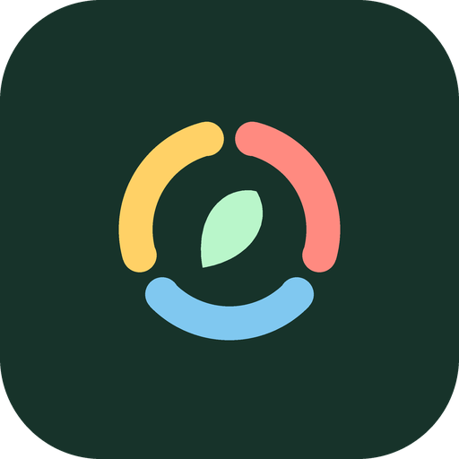

# Open Macros

A free, open-source **calorie, macro and weight tracker** for Android: a basic alternative to paid apps
like MacroFactor. Kotlin + Jetpack Compose + Material 3, minSdk 29 (Android 10), targetSdk 36.
No account, no ads, no subscription. Your data stays on your phone.

See [ARCHITECTURE.md](ARCHITECTURE.md) for how it's put together.

## Features (v1)

- **Food search** across [Open Food Facts](https://world.openfoodfacts.org) (packaged products, no key)
  and [USDA FoodData Central](https://fdc.nal.usda.gov) (whole foods + US branded products), merged and
  de-duplicated, with your own foods pinned on top.
- **Barcode scanning** with CameraX + ML Kit (bundled on-device model, no Google Play Services download),
  looked up in Open Food Facts. Not found? Create it as a custom food with the barcode pre-filled. You can
  also type a barcode.
- **Food diary** per day with breakfast, lunch, dinner and snacks. Amounts in servings, grams or ounces.
  **Recent** and **favorite** foods, **quick add** (calories only, or macros), and **custom foods**.
- **Daily summary**: a calorie ring and protein / carbs / fat bars against your targets.
- **Weight**: log weigh-ins (lb or kg), see a chart with a **smoothed trend line** (time-aware exponential
  moving average) plus a 7-day average and week/month change.
- **Goals**: onboarding asks sex, age, height, weight, activity level and goal (lose / maintain / gain at
  a chosen rate). Target = **Mifflin-St Jeor BMR × activity**, ± 7700 kcal per kg of weekly change ÷ 7,
  never below 1200 kcal. The macro split defaults to 30/40/30 % and is editable; you can also set a fixed
  calorie target. Logging a new latest weigh-in updates the weight used for the target.
- **Your data**: export a full JSON backup or a spreadsheet-friendly CSV, and import either one
  (Storage Access Framework, so you pick where files go). Nothing is uploaded anywhere.
- Follows the system light/dark theme with Material You dynamic color on Android 12+, edge-to-edge.

## Build and install

1. JDK 17 and the Android SDK (platform 36). Android Studio Ladybug or newer works.
2. `local.properties` (gitignored) only needs `sdk.dir=/path/to/Android/sdk`. Android Studio writes it.
   No API keys go into the build.
3. `./gradlew assembleDebug` (APK in `app/build/outputs/apk/debug/`) or `./gradlew installDebug`.
4. Unit tests: `./gradlew testDebugUnitTest` (TDEE math, trend/moving average, parsers, merge, backup).

CI: the workflow lives at [`ci/android.yml`](ci/android.yml). Move it to `.github/workflows/android.yml`
to enable it on GitHub Actions; it runs `assembleDebug` + unit tests and uploads the debug APK.

## USDA API key (optional, free)

USDA search needs an api.data.gov key. Without one the app uses the shared `DEMO_KEY`, which is limited to
about **30 requests an hour and 50 a day** per IP address, so you'll see "rate limit" messages quickly.
Get a free personal key (1,000 requests/hour) at <https://fdc.nal.usda.gov/api-key-signup> and paste it in
**Settings → USDA FoodData Central key**. It's stored only on the device, encrypted with
`EncryptedSharedPreferences` under an Android Keystore master key, never logged, never exported in backups,
and Android backup is disabled for the app.

Open Food Facts needs no key. Every request sends a `User-Agent` identifying the app
(`OpenMacros/<version> (Android; https://github.com/glinesbdev/open-macros)`) as OFF asks. Search is only run
when you submit, to stay well within OFF's rate limits.

## Data sources and attribution

- **Open Food Facts**: product data © Open Food Facts contributors, available under the
  [Open Database License (ODbL 1.0)](https://opendatacommons.org/licenses/odbl/1-0/); individual contents
  under the [Database Contents License](https://opendatacommons.org/licenses/dbcl/1-0/). Images are not used.
  The app credits OFF on the search, scan and food screens and in Settings → About. Open Macros caches
  products you open on your device; if you redistribute data derived from OFF, ODbL's share-alike terms apply.
- **USDA FoodData Central**: U.S. Department of Agriculture, Agricultural Research Service.
  FoodData Central data is in the public domain (CC0 1.0).

Crowd-sourced nutrition data can be incomplete or wrong. Check the label when it matters.
Calorie targets are estimates from a standard formula, not medical advice.

## Roadmap

- **Photo logging** (next phase): snap a meal, get an editable estimate of foods, grams, calories and
  macros from a vision model (e.g. Grok via the xAI API with your own key). The `FoodPhotoEstimator`
  interface is in place (`photo/FoodPhotoEstimator.kt`); there's no implementation or UI yet.
- Adaptive TDEE from your intake vs. weight trend, recipes, Health Connect sync.

## License

Open Macros' own code is under the [PolyForm Noncommercial License 1.0.0](LICENSE)
(`Required Notice: Copyright (c) 2026 Bradyn Glines`). Free for personal and other noncommercial use.
Third-party components and data keep their own licenses; see [THIRD_PARTY_NOTICES.md](THIRD_PARTY_NOTICES.md).
